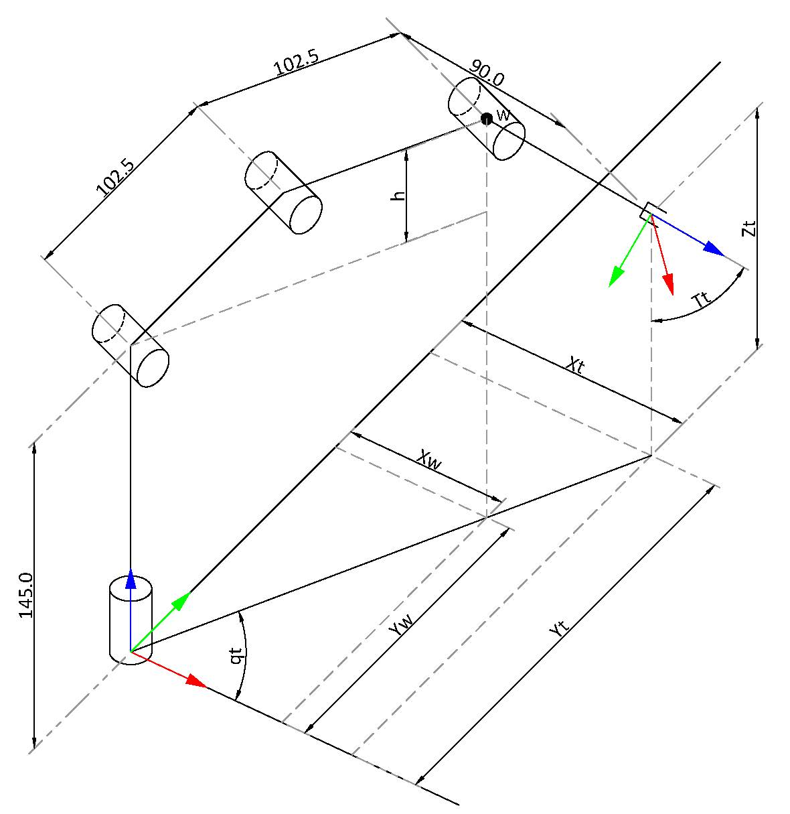
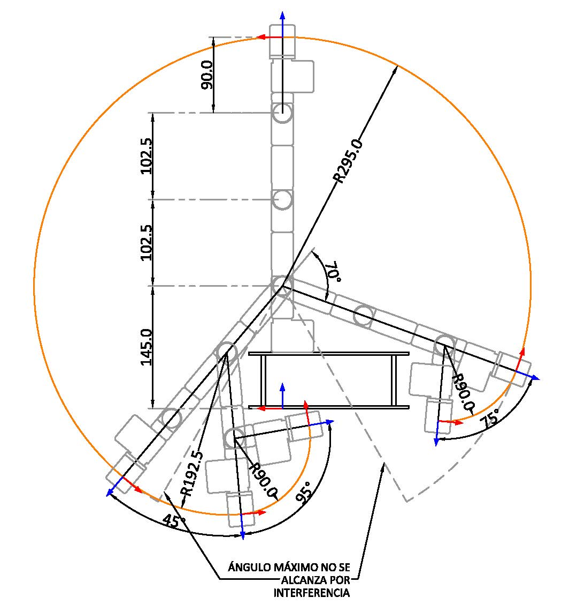
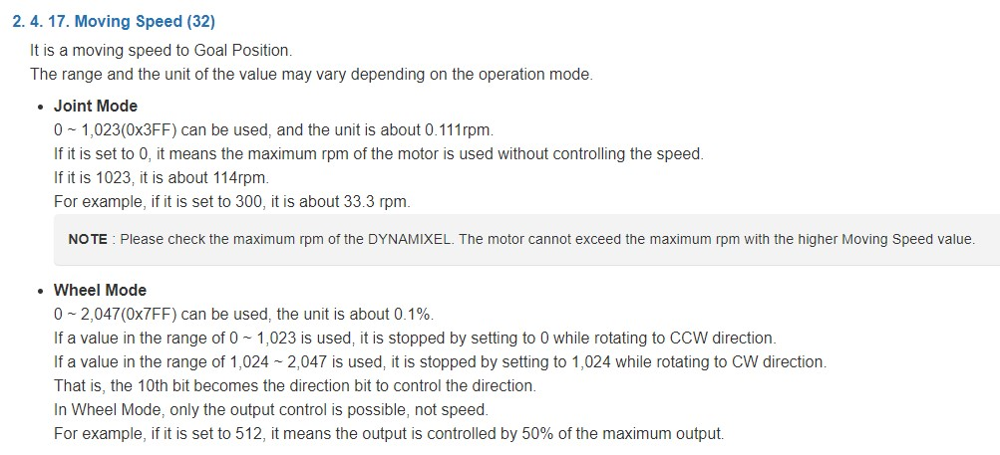
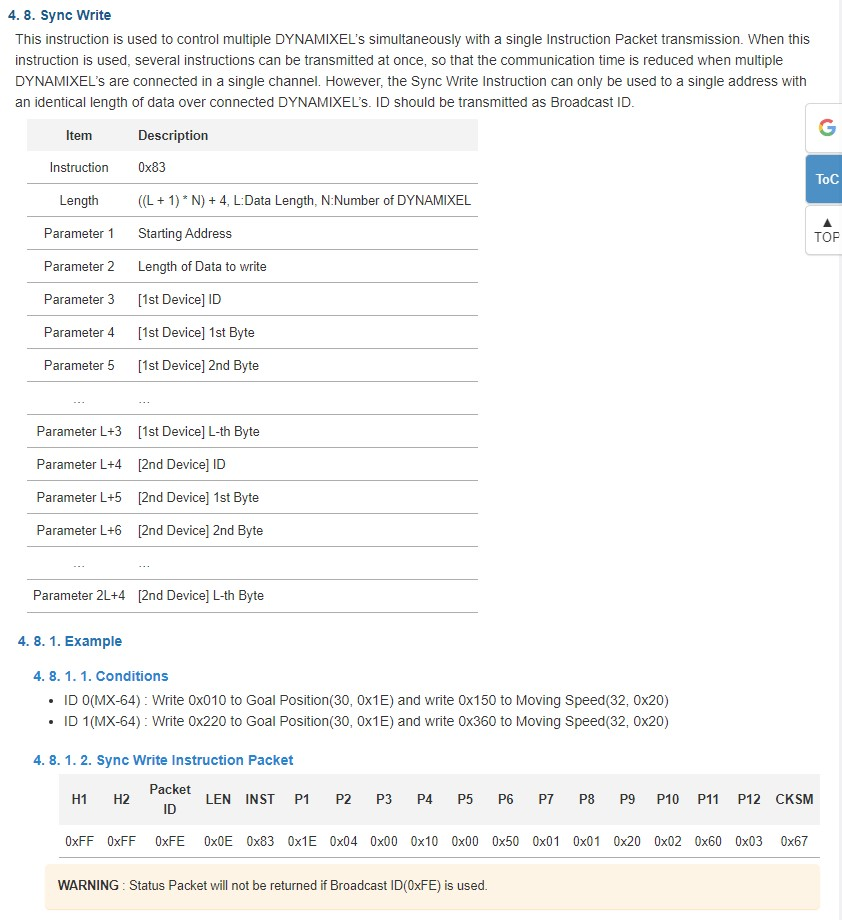

# Inverse Kinematics and Robot Control with PhantomX

**Laboratory 3 · ROS · MATLAB · Python**

**Authors**

- Rafael Ricardo Galindo Leon
- Diego Fabian Osorio Fonseca

---

## Inverse Kinematics



From the diagram above, we can derive the following relationships:

$$
T_T =
\begin{bmatrix}
n_x & o_x & a_x & x_T \newline
n_y & o_y & a_y & y_T \newline
n_z & o_z & a_z & z_T \newline
0 & 0 & 0 & 1
\end{bmatrix}
$$

$$r = \sqrt{x_T^2 + y_T^2}$$

$$h = z_w - l_1$$

$$
PosW =
\begin{bmatrix}
x_w \newline y_w \newline z_w
\end{bmatrix}
=
\begin{bmatrix}
x_T \newline y_T \newline z_T
\end{bmatrix}
-
l_4
\begin{bmatrix}
a_x \newline a_y \newline a_z
\end{bmatrix}
$$

### Joint 1

$$q_1 = atan(y_T / x_T) \rightarrow atan2(y_T, xT)$$

### Joint 2

Using the analysis of a 2R mechanism:

$$
\theta_3 =
acos\left(
\frac{r^2+h^2-l_2^2-l_3^2}{2 l_3 l_3}
\right)
$$

$$
q_2 = -\pi/2 + atan2(h,r) -
atan2(l_3 sin(\theta_3),l_2+l_3*cos(\theta_3))
$$

### Joint 3

$$q_3 = \theta_3$$

To switch between the elbow-up and elbow-down configurations, change the sign of $\theta_3$ when calculating $q_2$ and $q_3$.

### Joint 4

$$
R_{pitch} =
\begin{bmatrix}
cos(q_1) & sin(q_1) & 0 \newline
-sin(q_1) & cos(q_1) & 0 \newline
0 & 0 & 1
\end{bmatrix}
R_T
$$

$$pitch = atan2(R_{p31},R_{p11})$$

$$q_4 = pitch - q_2 - q_3$$

The inverse kinematics were implemented in the MATLAB function:

`px_robot/matlab/invKinPhantomX.m`

### Workspace

To determine the robot’s workspace, we created a simplified geometric diagram using measurements from the physical robot. We analyzed the workspace in the XZ plane at the origin, as this plane has the greatest variation. The XY workspace forms a complete circle due to the rotation of the first actuator, while the YZ workspace is very similar to the XZ workspace, with fewer restrictions caused by interference.

The resulting workspace has a hemispherical geometry with an internal void caused by the robot interfering with itself. To determine its boundaries, we considered the geometric model of each link, including the base, and examined the maximum angular movements of each joint. The limits occur where the robot begins to interfere with itself or its base, or where an actuator reaches its maximum position.

As shown below, the upper workspace can be approximated by a spherical geometry spanning 250°. The lower workspace has a different shape because of interference with the robot and its base. The diagram assumes that the robot can operate below its base, with no surface preventing this movement. This may change depending on the robot’s mounting system.

When one joint reaches a limit, either because of the motor or interference, the next joint can continue moving in the same direction until it also reaches a limit.

The origin is defined as the point collinear with the first joint at the lowest level of the base. The end-effector coordinate frame is placed at the center of the gripper jaws, approximately halfway up their height. This provides a safe operating area and allows some tolerance in the object’s position during grasping.



---

## Pick and Place

The pick-and-place implementation identifies the waypoints the end effector must follow and interpolates between them to generate trajectories. For each pose along the trajectory, the homogeneous transformation matrix is used to calculate inverse kinematics. The elbow-up solution is used throughout.

The implementation was developed in MATLAB.

### 1. Calculate trajectory waypoints

The waypoint coordinates define where the pieces will be placed during the assembly process. They are chosen near the center of the workspace, with a vertical end-effector approach angle to simplify the inverse kinematics calculations.

```matlab
%% Positions
%% Calculate the waypoints along the robot's trajectory.

d = 15; % Radius of the ascent and descent points
h = 5;  % Height offset between travel and grasping

TRa = transl(0,-d,10)*trotz(-pi/2)*troty(-pi); % Right, above
TRb = transl(0,-d,h)*trotz(-pi/2)*troty(-pi);  % Right, below

TLa = transl(0,d,10)*trotz(pi/2)*troty(-pi); % Left, above
TLb = transl(0,d,h)*trotz(pi/2)*troty(-pi);  % Left, below

TCa = transl(d,0,10)*troty(-pi); % Center, above
TCb = transl(d,0,h)*troty(-pi);  % Center, below
```

### 2. Define the robot’s geometry

The robot model is constructed from the measured geometry using the Denavit–Hartenberg convention. This makes it possible to check that the model corresponds to the physical robot and to verify its behavior and coordinate frames before operation.

```matlab
%% Robot plot
%% Define the robot's geometric parameters.

l = [14.5, 10.25, 10.25, 9]; % Link lengths

% Robot definition using Peter Corke's Robotics Toolbox
L(1) = Link('revolute','alpha',pi/2,'a',0,   'd',l(1),'offset',0,   'qlim',[-3*pi/4 3*pi/4]);
L(2) = Link('revolute','alpha',0,   'a',l(2),'d',0,   'offset',pi/2,'qlim',[-3*pi/4 3*pi/4]);
L(3) = Link('revolute','alpha',0,   'a',l(3),'d',0,   'offset',0,   'qlim',[-3*pi/4 3*pi/4]);
L(4) = Link('revolute','alpha',0,   'a',0,   'd',0,   'offset',0,   'qlim',[-3*pi/4 3*pi/4]);

PhantomX = SerialLink(L,'name','Px');
PhantomX.tool = [0 0 1 l(4); -1 0 0 0; 0 -1 0 0; 0 0 0 1];

% Plotting
q = [0 0 0 0]; % Home
q_rad = deg2rad(q);
PhantomX.plot(q_rad,'notiles','noname');
hold on
ws = [-50 50];
trplot(eye(4),'rgb','arrow','length',15,'frame','0')
axis([repmat(ws,1,2) 0 60])
```

### 3. Interpolate between waypoints

The trajectory is interpolated between waypoints, taking the direction of travel into account. Different numbers of interpolation points are used for horizontal and vertical movements so that the distances between points are approximately similar.

Vertical movements use slightly closer points because they involve interaction with the pieces and are more sensitive to errors or sudden movements. Repeated paths, such as the vertical paths at the center, are interpolated once.

```matlab
%% Trajectories
%% Interpolate between waypoints to create smoother paths.
%% Use different numbers of points for horizontal and vertical paths.

n = 30;  % Horizontal trajectory interpolations
n2 = 15; % Vertical trajectory interpolations

TC_R = ctraj(TCa,TRa,n);  % Center above → right above
TR_C = ctraj(TRa,TCa,n);  % Right above → center above
TC_L = ctraj(TCa,TLa,n);  % Center above → left above
TL_C = ctraj(TLa,TCa,n);  % Left above → center above
TC_a = ctraj(TCb,TCa,n2); % Center below → center above
TC_b = ctraj(TCa,TCb,n2); % Center above → center below
TR_a = ctraj(TRb,TRa,n2); % Right below → right above
TR_b = ctraj(TRa,TRb,n2); % Right above → right below
TL_a = ctraj(TLb,TLa,n2); % Left below → left above
TL_b = ctraj(TLa,TLb,n2); % Left above → left below
```

### 4. Determine gripper positions

The pieces were manufactured before determining the gripper’s opening and closing values. Since the gripper’s closing mechanism is nonlinear with respect to motor rotation, the values were measured manually using the Dynamixel interface.

The gripper was tested on a piece to ensure that it opened enough to fit around the piece and closed enough to prevent it from falling during movement, without risking damage to the mechanism or exceeding the motor’s torque capacity.

```matlab
%% Gripper positions
open = 0;
close = 0.8624; % mapfun(680,0,1023,deg2rad(-150),deg2rad(150))
```

### 5. Calculate inverse kinematics for the full trajectory

Once the homogeneous transformation matrices are available for every interpolated pose, inverse kinematics is used to calculate the joint angles needed to move the end effector to each position. The function uses the geometric and decoupling method described above.

```matlab
%% Calculate the complete trajectory using the waypoints
%% and interpolated points.

% Home
q_home = [0 0 0 0 open];

% Initial position → center above
qC_a = [P1 open];

% Center → right
for i=1:n
   qinv = invKinPhantomX(TC_R(:,:,i),'up');
   qC_R(i,:) = [qinv open];
end

% Right below and close
for i=1:n2
   qinv = invKinPhantomX(TR_b(:,:,i),'up');
   qR_b(i,:) = [qinv open];
end
qR_b = [qR_b; P3 open; P3 close];

% Right above
for i=1:n2
   qinv = invKinPhantomX(TR_a(:,:,i),'up');
   qR_a(i,:) = [qinv close];
end
% qR_a = [P2 close];

% Right → center
for i=1:n
   qinv = invKinPhantomX(TR_C(:,:,i),'up');
   qR_C(i,:) = [qinv close];
end

% Center below and open
for i=1:n2
   qinv = invKinPhantomX(TC_b(:,:,i),'up');
   qC_b(i,:) = [qinv close];
end
qC_b = [qC_b; P6 close; P6 open];

% Center above 2
for i=1:n2
   qinv = invKinPhantomX(TC_a(:,:,i),'up');
   qC_a2(i,:) = [qinv open];
end

% Center → left
for i=1:n
   qinv = invKinPhantomX(TC_L(:,:,i),'up');
   qC_L(i,:) = [qinv open];
end

% Left below and close
for i=1:n2
   qinv = invKinPhantomX(TL_b(:,:,i),'up');
   qL_b(i,:) = [qinv open];
end
qL_b = [qL_b; P5 open; P5 close];

% Left above
for i=1:n2
   qinv = invKinPhantomX(TL_a(:,:,i),'up');
   qL_a(i,:) = [qinv close];
end
qL_a = [qL_a; P4 close];

% Left → center
for i=1:n
   qinv = invKinPhantomX(TL_C(:,:,i),'up');
   qL_C(i,:) = [qinv close];
end

% Center below and open

% Center above 2
```

### 6. Assemble the complete trajectory

The motor angles for each trajectory segment are stacked into a single matrix. The required segments are repeated in the desired order.

```matlab
% Complete matrix of joint values for the trajectory
qTotal = [q_home;
          qC_a;
          qC_R;
          qR_b;
          qR_a;
          qR_C;
          qC_b;
          qC_a2;
          qC_L;
          qL_b;
          qL_a;
          qL_C;
          qC_b;
          qC_a2];
```

### 7. Initialize the ROS service

With the trajectory points and their joint values calculated, the ROS connection and motor command service are initialized.

```matlab
%% ROS connection
rosinit

%% Create the service client and message
motorSvcClient = rossvcclient('dynamixel_workbench/dynamixel_command');
motorCommandMsg = rosmessage(motorSvcClient);
```

### 8. Configure maximum speed

The PhantomX AX-12 motors are configured using the `Moving_Speed` function described in the Dynamixel manual. Compared with the `Torque_Limit` setting used previously, a speed limit allows the motors to use the available torque when a trajectory requires it.

Reducing speed also makes movements less abrupt, reduces mechanical and electrical strain, and provides more time to respond to a potential collision.

Detailed information is available in the [Dynamixel Moving Speed documentation](https://emanual.robotis.com/docs/en/dxl/ax/ax-12w/#moving-speed).



```matlab
%% Configure maximum speed for all joints to avoid
%% high-speed movements while retaining motor torque.

motorCommandMsg.AddrName = "Moving_Speed";
motorCommandMsg.Value = 100;

motorCommandMsg.Id = 1;
call(motorSvcClient,motorCommandMsg);
motorCommandMsg.Id = 2;
call(motorSvcClient,motorCommandMsg);
motorCommandMsg.Id = 3;
call(motorSvcClient,motorCommandMsg);
motorCommandMsg.Id = 4;
call(motorSvcClient,motorCommandMsg);
motorCommandMsg.Id = 5;
call(motorSvcClient,motorCommandMsg);
```

### 9. Execute the movements

An iterative function sends each target value to the corresponding motor. The movements are executed consecutively, so paths involving multiple motors appear stepped and abrupt. After a movement command is sent, the system waits for the motor’s response before sending the next command, preventing simultaneous movement.

Dynamixel Protocol 1.0 provides a possible solution through **Sync Write**:



As described in the [Dynamixel Protocol 1.0 documentation](https://emanual.robotis.com/docs/en/dxl/protocol1/#instruction-details), Sync Write can send `Goal Position` and `Moving Speed` commands to multiple motors simultaneously. This could produce smoother movements closer to the desired trajectory, particularly when consecutive points are close together.

Simultaneous commands could also reduce repeated acceleration and deceleration and reduce communication bus usage, since a separate command and response would not be required for each motor.

This function was not implemented in the library used for the laboratory, so it was not used.

```matlab
%% Execute the planned trajectory for all joints.
%% With Goal_Position, the next action waits until
%% the previous action has completed.

motorCommandMsg.AddrName = "Goal_Position";

for j=1:length(qTotal)
    for i=1:5
        if j~=1
           if qTotal(j,i)~=qTotal(j-1,i)
               motorCommandMsg.Id = i;
               motorCommandMsg.Value = round(mapfun(qTotal(j,i),deg2rad(-150),deg2rad(150),0,1023));
               call(motorSvcClient,motorCommandMsg);
           end
        else
            motorCommandMsg.Id = i;
            motorCommandMsg.Value = round(mapfun(qTotal(j,i),deg2rad(-150),deg2rad(150),0,1023));
            call(motorSvcClient,motorCommandMsg);
        end
    end
end
```

---

## Movement in Task Space

For the second part of the laboratory, we developed a Python script named `keyboardMove.py`, located in `px_robot/scripts`. The script also contains the inverse kinematics function implemented in MATLAB.

### Modifying the tool pose

The main function, `changeT`, modifies the tool center point (TCP) transformation matrix. It receives three arguments:

| Argument | Description |
| --- | --- |
| `numMov` | Movement type. Values 1–3 correspond to translation along X, Y, and Z. Value 4 corresponds to rotation about the TCP’s O axis. |
| `T_actual` | Current transformation matrix to modify. |
| `direction` | `1` for positive movement or `-1` for negative movement. |

The function first obtains the TCP position and Euler angles using functions from Peter Corke’s toolbox. It then modifies the position or orientation according to the selected movement.

For example, a Y translation changes the Y position and one of the Euler angles. Finally, the function calculates and returns a new transformation matrix using the updated values.

```python
def changeT(numMov, T_actual, direction):
    X, Y, Z = transl(T_actual)
    aZ1, aY, aZ2 = tr2eul(T_actual)  # Check toolbox usage in Python
    print(aZ2)
    d_tra = 1
    d_rot = 2*np.pi/180

    if numMov == 1:
        X = X + direction*d_tra
        aZ2 = -np.arctan2(Y,X)
    if numMov == 2:
        Y = Y + direction*d_tra
        aZ2 = -np.arctan2(Y,X)
    if numMov == 3:
        Z = Z + direction*d_tra
    if numMov == 4:
        aY = aY + direction*d_rot

    b = np.array([[X], [Y], [Z]])
    T_actual = rt2tr(eul2r(aZ1,aY,aZ2),b)
    return T_actual
```

### Supporting functions

**`setMovingSpeed`** sets the motors’ movement speed to the given `speed` value in bits.

```python
def setMovingSpeed(speed):
    for i in range(4):
        jointCommand('',i+1, 'Moving_Speed',speed, 0)  # Update if motor IDs change
```

**`moveLinks`** commands each motor to the desired joint position. Its input contains joint values in radians.

```python
def moveLinks(links):
    for i in range(4):
        jointCommand('',i+1, 'Goal_Position',round((links[i]-(-5*np.pi/6))*(1023/(5*np.pi/3))), 0)  # Update if motor IDs change
```

**`checkJointsValues`** checks whether the values in `q` are within the robot’s joint limits.

```python
def checkJointsValues(q):
    max = np.deg2rad(150)
    min = np.deg2rad(-150)

    if q[0]<max and q[0]>min:
        q1 = True
    else:
        q1 = False
        print("q1 value out of Limits")

    if q[1]<max and q[1]>min:
        q2 = True
    else:
        q2 = False
        print("q2 value out of Limits")

    if q[2]<max and q[2]>min:
        q3 = True
    else:
        q3 = False
        print("q3 value out of Limits")

    if q[3]<max and q[3]>min:
        q4 = True
    else:
        q4 = False
        print("q4 value out of Limits")

    return q1 and q2 and q3 and q4
```

### Keyboard control

The main program first defines an initial robot pose as a homogeneous transformation matrix and calculates its joint values using inverse kinematics. The motor speed is configured before the robot moves to this initial pose.

The program then enters a continuous loop in which the user selects a movement type and commands movement in either direction.

| Key | Action |
| --- | --- |
| **W** | Increase the selected movement type |
| **S** | Decrease the selected movement type |
| **D** | Move in the positive direction |
| **A** | Move in the negative direction |

For each movement, `changeT` updates the current transformation matrix using the selected movement type and direction. The program then calculates inverse kinematics for the new pose and commands the motors if the resulting joint values are within their limits.

---

## Results

### Video

[Watch the pick-and-place and task-space movement demonstration](https://youtu.be/Qm2VoXwQtFI)

## Conclusions

- Inverse kinematics is a fundamental part of practical robotics. Applications typically specify a desired position and orientation, and inverse kinematics provides the joint values needed to command each actuator to reach that pose.
- This laboratory showed how ROS, Python, and MATLAB can be used to develop applications with industrial relevance, such as pick and place.
- Smoother movement would require a service capable of commanding all motors simultaneously. Dynamixel supports this capability, but it was not available in the ROS package services used for this laboratory.
